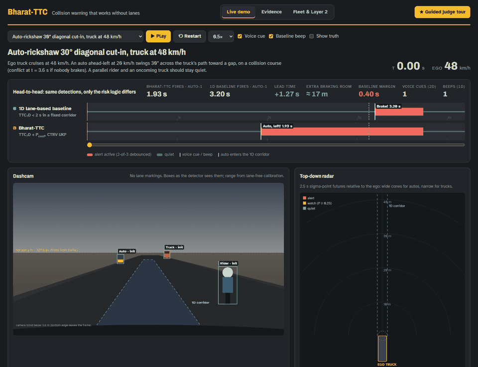
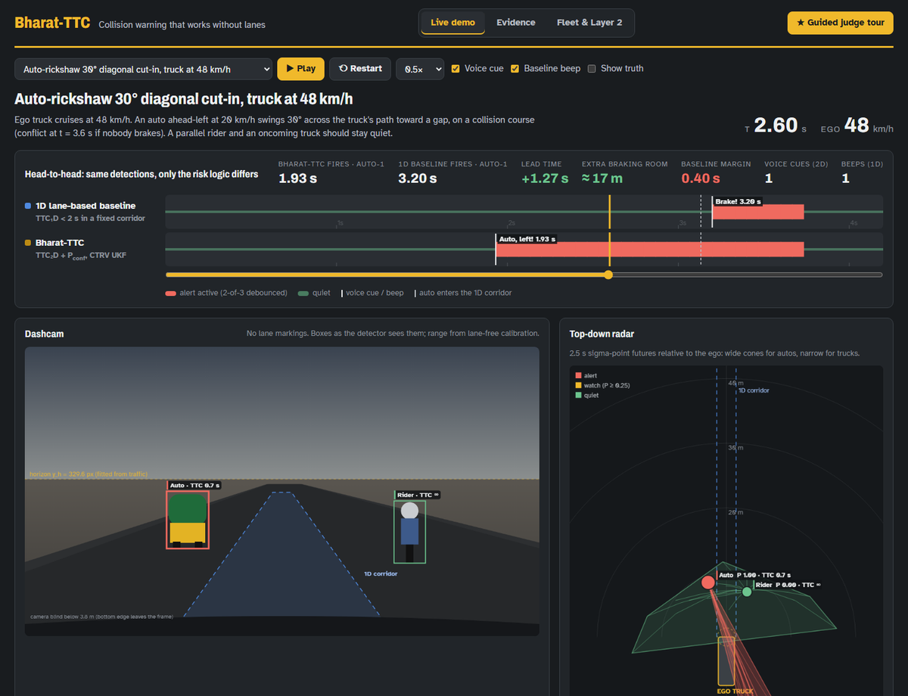
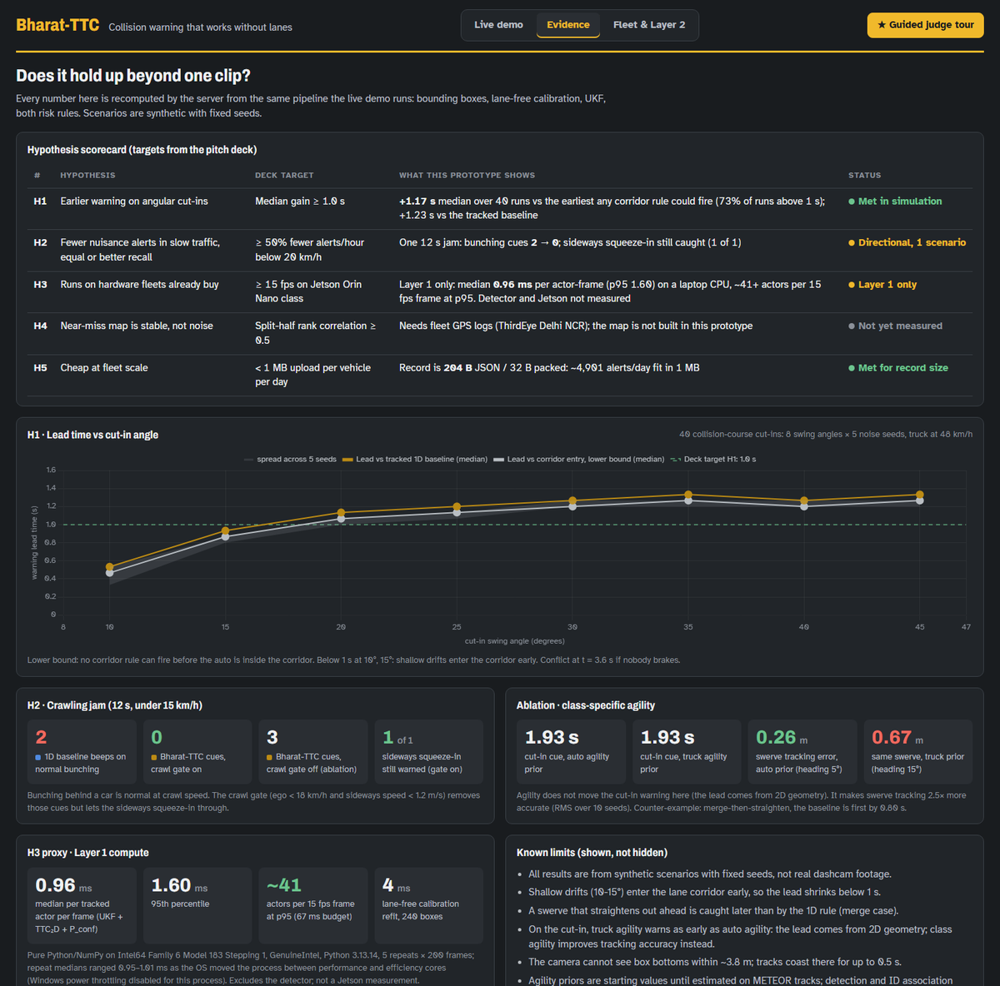

# Bharat-TTC — Layer 1 prototype

Stages B–E of the idea submission, end to end on synthetic bounding boxes:
lane-free calibration (B), class-specific CTRV unscented Kalman tracking (C),
2D conflict scoring (D) and the alert policy (E), compared head-to-head with a
lane-based 1D-TTC baseline. Detection and ID association (stage A) and the
near-miss map (Layer 2) are not here.



*Truck at 48 km/h, auto swinging 30° across its path. Bharat-TTC says "Auto, left!" at
1.93 s while the auto is still outside the lane corridor; the lane-based baseline only
beeps at 3.20 s. Synthetic scenario, fixed seed.*

| Live demo | Evidence |
|---|---|
|  |  |

| Module | What it does |
|---|---|
| `bharat_ttc/camera.py` | Lane-free calibration: robust fit (sklearn `HuberRegressor` / `RANSACRegressor`) of w/W_c = y_b/h − y_h/h over car (1.75 m) and auto (1.35 m) boxes. Pixel → ground `Z = fh/(y_b−y_h)`, `X = (x−c_x)h/(y_b−y_h)`, `σ_Z = Z²σ_y/(fh)` |
| `bharat_ttc/motion_models.py` | CTRV transition (straight branch at \|ψ̇\| ≤ 1e‑4), class agility priors (`CLASS_AGILITY`), heading-aware process noise `Q = G·diag(σ_a², σ_ψ̈²)·Gᵀ`, `estimate_agility()` |
| `bharat_ttc/ukf.py` | `CTRVUKF` on `filterpy.kalman.UnscentedKalmanFilter` + `MerweScaledSigmaPoints`; Q rebuilt every sub-step from class and heading; augmented sigma points for P_conf |
| `bharat_ttc/risk.py` | Closed-form `ttc_2d`, sigma-point `conflict_probability` (2.5 s), `crawl_gate` (ego < 18 km/h and \|v_x\| < 1.2 m/s), 1D baseline, 2-of-3 debounce + cooldown `AlertPolicy` |
| `bharat_ttc/sim.py` | Deterministic scenarios: truth → noisy boxes → calibration → UKF → both risk rules |
| `bharat_ttc/records.py` | Layer 2 near-miss record per alert (H3 res-9 cell, time, speed, min TTC, decel, class, lighting, DRAC); 204 B JSON / 32 B packed |
| `bharat_ttc/evidence.py` | H1 sweep, H2 jam comparison, agility ablation, merge counter-example, Layer 1 compute benchmark |
| `demo_cut_in.py` | Terminal timeline of the 48 km/h auto cut-in, sweep, ablations, crawl-jam counts, record and runtime |
| `web/` | FastAPI + Canvas + Chart.js judge dashboard: Live demo, Evidence, Fleet & Layer 2 tabs, guided tour, voice cues |
| `run_dashboard.bat`, `DEMO.md` | One-click launcher and the 3-minute presenter runbook |

Agility priors: auto-rickshaw / rider σ_a = 2.6 m/s², σ_ψ̈ = 1.2 rad/s²; bus / truck
σ_a = 1.2, σ_ψ̈ = 0.25. They are starting values until estimated on METEOR tracks.

## Run

Requires Python 3.10+.

**Windows, one click:** double-click `run_dashboard.bat`. On first run it creates
`.venv` inside the repo and installs `requirements.txt` (about 5 minutes on first run, needs internet), then
opens the dashboard. The `.bat` launcher is Windows-only.

**Manual, Windows:**

```
python -m venv .venv
.venv\Scripts\python.exe -m pip install -r requirements.txt
.venv\Scripts\python.exe -m pytest -q
.venv\Scripts\python.exe demo_cut_in.py
.venv\Scripts\python.exe -m uvicorn web.server:app --port 8000
```

**Manual, macOS / Linux:**

```
python3 -m venv .venv
.venv/bin/python -m pip install -r requirements.txt
.venv/bin/python -m pytest -q
.venv/bin/python demo_cut_in.py
.venv/bin/python -m uvicorn web.server:app --port 8000
```

Open http://127.0.0.1:8000 and press
**★ Guided judge tour** (a click is needed before the browser allows speech).
Deep links: `/?scenario=jam&t=9.2`, `/?tab=evidence`, `/?tour=1`. Space toggles
play/pause, Esc exits the tour.

## What the synthetic runs show

Truck at 48 km/h, auto at 20 km/h swinging 30° across its path (collision course):

- Bharat-TTC voice cue "Auto, left!" at 1.93 s, 1.67 s before the conflict
- 1D baseline beeps at 3.20 s, 0.40 s before the conflict → lead +1.27 s, ~17 m more
  braking room at 48 km/h (1.27 s × 13.3 m/s). Against the stricter corridor-entry
  bound the lead is +1.20 s (~16 m).
- Across 10–45° swings × 5 seeds, median lead over the earliest any corridor rule could
  fire (true corridor entry) is +1.17 s; below 15° it drops under 1 s
- Parallel rider: TTC_2D = ∞ throughout; oncoming truck: no alert
- Crawling jam: baseline beeps 2× on normal bunching, the crawl-gated 2D rule 0×,
  and the sideways auto squeeze-in still gets a cue
- Each alert's near-miss record is 204 bytes as JSON (32 packed): ~4,900 alerts/day fit the 1 MB budget
- Layer 1 costs ~1–2 ms per tracked actor per frame on a laptop CPU (pure Python, detector excluded;
  efficiency-core scheduling can push it higher, and the Evidence tab shows the spread)

Honest limits, also printed by the demo:

- A swerve that straightens out ahead ("merge") is caught 0.8 s *later* than by the 1D rule.
- On the cut-in, tracking the auto with truck agility warns at the same time: the lead
  comes from the 2D geometry. Class agility shows up in tracking (swerve position RMS
  0.27 m with the auto prior vs 0.68 m with the truck prior).
- The camera cannot see box bottoms within ~3.8 m; tracks coast there for up to 0.5 s.

All numbers come from synthetic scenarios with fixed seeds, not real footage.

## Licence

Apache-2.0 (see `LICENSE`). Chart.js in `web/static/vendor/` is MIT-licensed.
